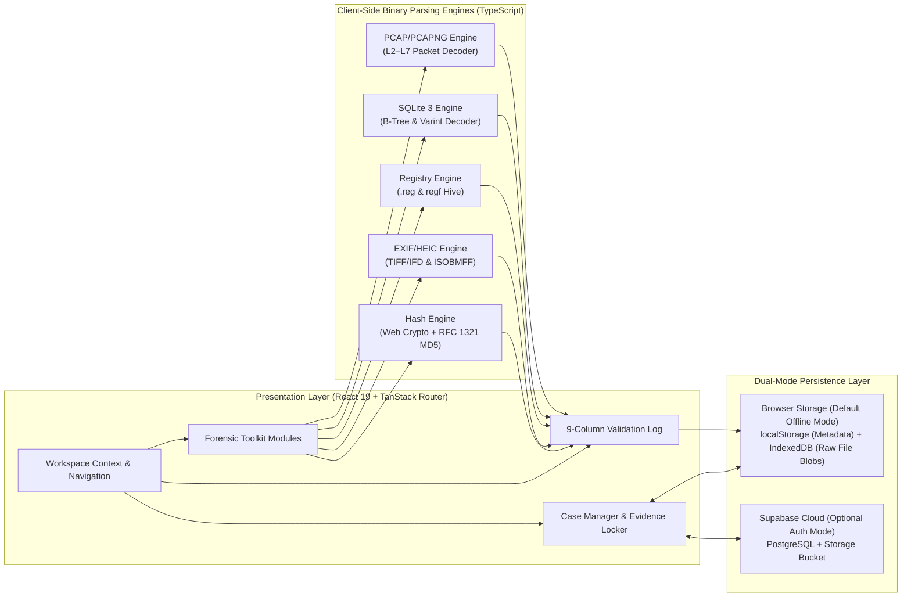

# DeadByte — Digital Forensics Investigation Platform

> **Every Byte Leaves a Trace.**  
> A deterministic, client-side digital forensics workspace built for **NWIT 263 (Fall 2026)** that preserves original evidence, parses binary artifacts locally in the browser, and enforces independent tool validation.

---


## 1. Problems DeadByte Solves

- **Fragmented Forensic Tooling:** Investigators normally switch between separate utilities for file hashing, image metadata, Windows Registry hives, SQLite databases, and PCAP network captures. DeadByte unifies them into one case-centric workspace.
- **Evidence Privacy & Integrity Risks:** Uploading sensitive forensic artifacts to third-party servers risks data exposure or accidental alteration. DeadByte performs **100% of binary parsing client-side** inside the investigator's browser while preserving untouched raw binaries in an isolated Evidence Locker.
- **Unverified / "Black-Box" Outputs:** Many automated tools mix raw facts with unverified guesses. DeadByte strictly separates **Observed Facts** (attributed to exact byte offsets, Registry key paths, `table:rowid`, or `Frame #`) from **Interpretation**, and requires verification against external tools (`PowerShell`, `ExifTool`, `reg query`, `sqlite3`, `Wireshark/tshark`) via a **9-Column Independent Validation Log**.
- **File Spoofing & Anti-Forensics:** Attackers often disguise files by changing extensions (e.g., renaming an executable or database to `.jpg`). Every DeadByte analyzer inspects raw magic bytes at offset `0x00` to flag spoofed extensions immediately.

---

## 2. Core Forensic Modules

| Module | Route | Key Capabilities |
| :--- | :--- | :--- |
| **Case & Evidence Locker** | `/cases` · `/evidence` | Sequential Evidence IDs (`E-001`), automatic intake `SHA-256` baseline hashing, raw binary preservation (`IndexedDB`), and a timestamped chain-of-custody activity log. |
| **Hash Analyzer** | `/tools/hash` | Multi-algorithm cryptographic hashing (`SHA-256`, `SHA-384`, `SHA-512`, `SHA-1`, `MD5`), baseline integrity comparison, magic-byte spoofing checks, and CLI validation. |
| **EXIF & Image Analyzer** | `/tools/exif` | Binary header & IFD parser for `JPEG`, `PNG`, `TIFF`, `WebP`, and Apple iPhone `.HEIC` (`ftyp`, `ispe`, camera make/model, UTC capture timestamps, and DMS/decimal GPS coordinates). |
| **Windows Registry Analyzer** | `/tools/registry` | Parses `.reg` exports (`UTF-16LE`/`UTF-8`) and binary `regf` hives (`NTUSER.DAT`, `SYSTEM`, `SOFTWARE`, `SAM`) to extract OS identity, `Run`/`RunOnce` persistence, `USBSTOR` history, and user activity. |
| **SQLite Artifact Analyzer** | `/tools/sqlite` | Read-only SQLite 3 binary engine that inspects the 100-byte header, `sqlite_master` catalog on Page 1, and B-Tree leaf/interior pages (`0x0D`/`0x05`) with `table:rowid` attribution. |
| **Network / PCAP Analyzer** | `/tools/network` | Binary `.pcap` and `.pcapng` packet parser for `Ethernet`, `IPv4/IPv6`, `ARP`, `TCP`, `UDP`, `ICMP`, `DNS` queries/answers, `HTTP` headers, and `TLS ClientHello SNI` hostnames. |
| **9-Column Validation Log** | `/validation` | Records side-by-side comparisons between DeadByte's findings and independent forensic tools (`VERIFIED`, `MISMATCH`, `NEEDS REVIEW`) with CSV/JSON export. |

---

## 3. System Architecture



---

## 4. Tech Stack

- **Language:** TypeScript (`.ts` / `.tsx`), HTML5, CSS3, SQL
- **Frontend Framework:** React 19, Vite 8, TanStack Router & TanStack Query
- **Styling & UI:** Custom Cyber-Forensics Dark Theme + Tailwind CSS + Lucide Icons
- **Binary & Crypto Processing:** Native Browser `ArrayBuffer`, `DataView`, `Uint8Array`, Web Crypto API (`crypto.subtle`), plus pure-TypeScript `MD5`, `SHA-1`, and `SHA-256` engines
- **Storage:** Browser `localStorage` & `IndexedDB` (`deadbyte_files`) with optional Supabase PostgreSQL & Storage integration

---

## 5. Quick Start (Run Locally)

### Prerequisites
- [Node.js](https://nodejs.org/) (v18+ LTS recommended)

### Installation & Startup
```bash
# 1. Clone the repository
git clone https://github.com/dagimend07/Project_DeadByte.git
cd Project_DeadByte

# 2. Install dependencies
npm install

# 3. Start the development server
npm run dev
```

Open the local URL displayed in your terminal (e.g., `http://localhost:3000`) to start investigating.

---

## License
Distributed under the license specified in [`LICENSE`](./LICENSE).
